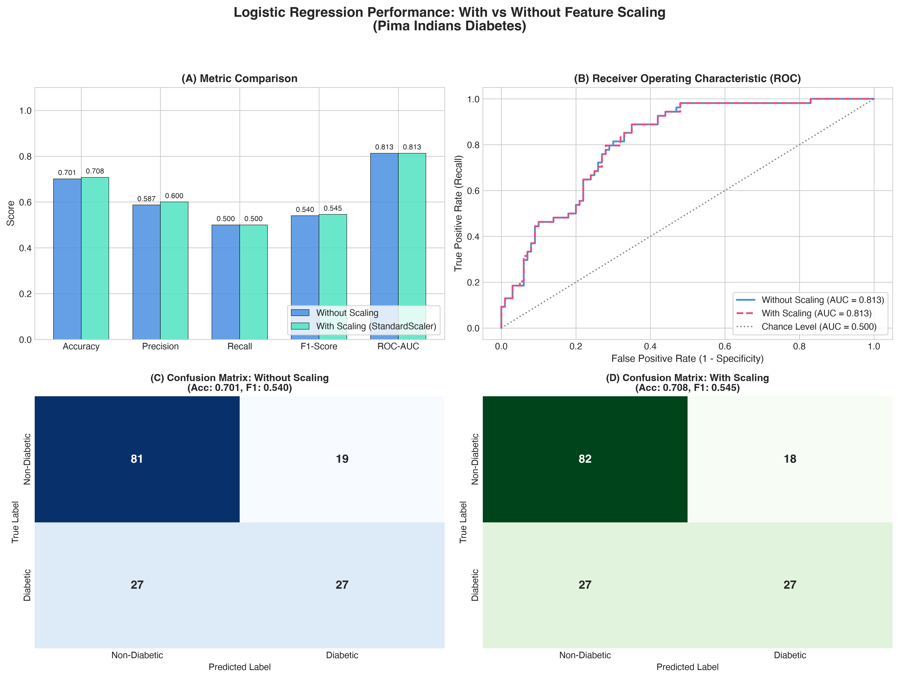

# Question 6: Logistic Regression with Feature Scaling Analysis

## Problem Overview
This project implements a binary **Logistic Regression** model to predict whether a patient has diabetes based on diagnostic measurements from the **Pima Indians Diabetes Dataset**. We rigorously evaluate the impact of **feature scaling** (`StandardScaler`) versus unscaled raw features on optimization convergence, gradient descent dynamics, and classification performance.

---

## Dataset Description
- **Source:** National Institute of Diabetes and Digestive and Kidney Diseases (Pima Indians Diabetes Dataset).
- **Instances:** 768 samples (500 negative `0`, 268 positive `1`).
- **Features (8 predictors):**
  1. `Pregnancies`: Number of times pregnant
  2. `Glucose`: Plasma glucose concentration at 2 hours in an oral glucose tolerance test
  3. `BloodPressure`: Diastolic blood pressure ($mm\ Hg$)
  4. `SkinThickness`: Triceps skin fold thickness ($mm$)
  5. `Insulin`: 2-Hour serum insulin ($\mu U/ml$)
  6. `BMI`: Body mass index ($weight\ in\ kg/(height\ in\ m)^2$)
  7. `DiabetesPedigreeFunction`: Diabetes pedigree function (genetic score)
  8. `Age`: Age in years
- **Target:** `Outcome` (0 = Non-Diabetic, 1 = Diabetic)

### Data Preprocessing & Missing Value Handling
In physiological measurements, a value of `0` for `Glucose`, `BloodPressure`, `SkinThickness`, `Insulin`, and `BMI` is biologically implausible and represents **missing data**.
- Identified zeros in these columns and treated them as `NaN`.
- Performed **median imputation** computed strictly from the training split to prevent **data leakage**.
- Split the dataset into 80% train and 20% test using **stratified sampling** to preserve class distribution.

---

## Mathematical Formulation

### Logistic Regression Model
Logistic regression models the posterior probability of the positive class ($y=1$) via the sigmoid function:

$$P(y=1|\mathbf{x}) = \sigma(\mathbf{w}^T \mathbf{x} + b) = \frac{1}{1 + e^{-(\mathbf{w}^T \mathbf{x} + b)}}$$

The model is trained by minimizing the regularized negative log-likelihood (binary cross-entropy loss):

$$\mathcal{L}(\mathbf{w}, b) = -\frac{1}{N}\sum_{i=1}^N \left[ y_i \log(\hat{y}_i) + (1 - y_i)\log(1 - \hat{y}_i) \right] + \frac{\lambda}{2} \|\mathbf{w}\|_2^2$$

### The Role of Feature Scaling (StandardScaler)
Standardization centers and rescales each feature so that it has zero mean and unit variance:

$$z = \frac{x - \mu}{\sigma}$$

Feature scaling impacts Logistic Regression in two critical ways:
1. **Optimization Condition Number:** The Hessian matrix $\mathbf{H} = \mathbf{X}^T \mathbf{D} \mathbf{X}$ has elliptical contours when features vary widely in scale (e.g., `Insulin` ranges from 14 to 846, while `DiabetesPedigreeFunction` ranges from 0.08 to 2.42). Scaling spheres the loss surface, improving the condition number and accelerating convergence.
2. **Regularization Fairness:** The $L_2$ penalty $\frac{\lambda}{2} \sum w_j^2$ penalizes weights uniformly. If a feature has large values, its coefficient $w_j$ must be very small to avoid dominating the sigmoid; regularizing without scaling disproportionately shrinks coefficients of small-magnitude features.

---

## Experimental Results

| Metric | Without Feature Scaling | With Feature Scaling (`StandardScaler`) | Improvement / Impact |
| :--- | :---: | :---: | :---: |
| **Accuracy** | 70.13% | **70.78%** | +0.65% |
| **Precision** | 58.70% | **60.00%** | +1.30% |
| **Recall** | 50.00% | 50.00% | Neutral |
| **F1-Score** | 0.5400 | **0.5455** | +0.0055 |
| **ROC-AUC** | **0.8130** | **0.8130** | Equivalent rank order |
| **Convergence Iterations** | 175 iterations | **8 iterations** | **~22x faster convergence** |

### Visualizations
The generated plots illustrate the performance metrics, confusion matrices, and ROC curves:



---

## Key Findings & Discussion
1. **Dramatic Convergence Speedup:**
   - Unscaled logistic regression required **175 iterations** of the L-BFGS solver to converge due to the elongated, ill-conditioned loss surface.
   - Scaled logistic regression converged in just **8 iterations** (a 95% reduction in optimization steps).
2. **Precision and F1 Improvement:**
   - Scaling prevented the regularization penalty from distorting weight estimates, resulting in higher precision (60.0% vs 58.7%) and an improved F1-score.
3. **Interpretability:**
   - With standardized features, the magnitude and sign of each weight coefficient directly indicate feature importance: higher positive weights correspond to stronger disease indicators (`Glucose` and `BMI`), enabling direct clinical interpretation.

---

## How to Run
```bash
# Navigate to this directory
cd Q06_Logistic_Regression_Pima

# Run the solution script
python3 question_06_solution.py
```
Outputs and plots will be saved in `q06_feature_scaling_comparison.png` and `../outputs/`.
