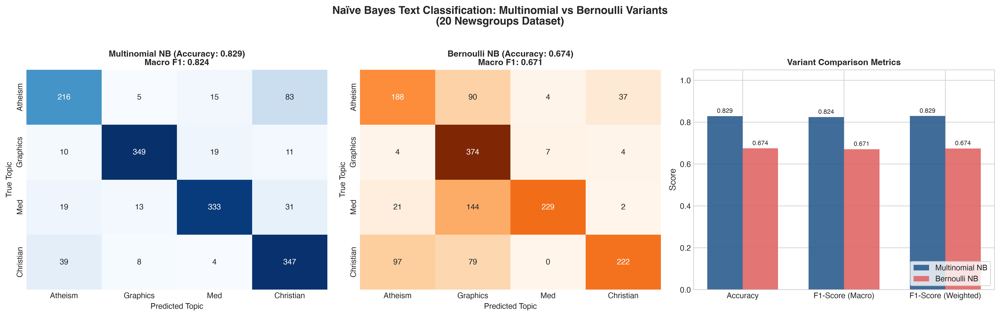

# Question 7: Multinomial vs. Bernoulli Naïve Bayes on 20 Newsgroups

## Problem Overview
This project implements and compares two foundational probabilistic text classification algorithms: **Multinomial Naïve Bayes** and **Bernoulli Naïve Bayes**, applied to the **20 Newsgroups dataset**. We investigate how the mathematical modeling of term frequency versus binary term occurrence influences classification performance across diverse thematic categories.

---

## Dataset Description
- **Dataset:** 20 Newsgroups (`fetch_20newsgroups`).
- **Data Splits:** 2,257 training documents, 1,502 test documents.
- **Preprocessing:**
  - Stripped email headers, footers, and quote blocks (`remove=('headers', 'footers', 'quotes')`) to ensure the classifiers learn genuine thematic vocabulary rather than spurious sender identities.
  - Tokenized using standard English stop-word removal, frequency filtering (`min_df=3`, `max_df=0.85`), resulting in an 8,894-word vocabulary.
- **Evaluated Categories:**
  - `alt.atheism` (Philosophy / Religion)
  - `comp.graphics` (Computer Science / Graphics)
  - `sci.med` (Natural Science / Medicine)
  - `soc.religion.christian` (Society / Theology)

---

## Theoretical & Mathematical Formulations

Under Bayes' Theorem, the posterior probability of document $\mathbf{x}$ belonging to class $c$ is:

$$P(c|\mathbf{x}) = \frac{P(c) P(\mathbf{x}|c)}{P(\mathbf{x})} \propto P(c) \prod_{j=1}^{V} P(x_j|c)$$

### 1. Multinomial Naïve Bayes (MNB)
Multinomial NB models document generation as drawing tokens from a multinomial distribution over the vocabulary. The feature vector $\mathbf{x} = (x_1, \dots, x_V)$ contains integer token frequencies (word counts):

$$P(\mathbf{x}|c) = \frac{(\sum_j x_j)!}{\prod_j x_j!} \prod_{j=1}^V \theta_{cj}^{x_j}$$

With Laplace smoothing ($\alpha = 1$):

$$\hat{\theta}_{cj} = \frac{N_{cj} + \alpha}{N_c + \alpha V}$$

where $N_{cj}$ is the total count of word $j$ in class $c$, and $N_c$ is the total token count in class $c$.
- **Key Property:** Words repeated multiple times contribute proportionally ($x_j \log \theta_{cj}$) to the log-posterior.

### 2. Bernoulli Naïve Bayes (BNB)
Bernoulli NB models each token as an independent boolean variable $x_j \in \{0, 1\}$ (word present or absent). The likelihood is:

$$P(\mathbf{x}|c) = \prod_{j=1}^V \left[ \theta_{cj}^{x_j} (1 - \theta_{cj})^{1 - x_j} \right]$$

With Laplace smoothing ($\alpha = 1$):

$$\hat{\theta}_{cj} = \frac{D_{cj} + \alpha}{D_c + 2\alpha}$$

where $D_{cj}$ is the number of documents in class $c$ containing word $j$, and $D_c$ is the number of documents in class $c$.
- **Key Property:** Non-occurrence of a word is explicitly multiplied into the likelihood through $(1 - \theta_{cj})$.

---

## Experimental Results

| Classifier | Accuracy | Precision (Weighted) | Recall (Weighted) | F1-Score (Macro) | F1-Score (Weighted) | Training Time | Inference Time |
| :--- | :---: | :---: | :---: | :---: | :---: | :---: | :---: |
| **Multinomial NB** | **82.89%** | **83.40%** | **82.89%** | **0.8240** | **0.8291** | 0.010 s | 0.0004 s |
| **Bernoulli NB** | 67.44% | 74.33% | 67.44% | 0.6707 | 0.6743 | 0.001 s | 0.0007 s |
| **Multinomial NB (TF-IDF)** | **83.29%** | **84.47%** | **83.29%** | **0.8240** | **0.8305** | 0.001 s | 0.0004 s |

### Visualizations
The side-by-side confusion matrices and comparative bar charts are shown below:



---

## Strengths and Weaknesses of Each Variant

### Multinomial Naïve Bayes
- **Strengths:**
  - **Captures Frequency Signal:** Repeated domain keywords (e.g., repeated mentions of *"algorithm"*, *"render"*, *"prescription"*) significantly increase class confidence.
  - **Ideal for Longer Documents:** Document length variability is naturally tolerated because the model focuses on the distribution of words that *did* appear.
  - **Highest Accuracy:** Achieves **82.89%** accuracy and **0.824** Macro F1 on full newsgroup posts.
- **Weaknesses:**
  - Disregards absent words completely; does not penalize a class when an expected word is missing.

### Bernoulli Naïve Bayes
- **Strengths:**
  - **Explicit Absence Penalty:** If a signature word is absent from a document, the $(1 - \theta_{cj})$ factor explicitly reduces the likelihood for that class.
  - **Excellent for Short Texts:** Thrives on short snippets, tweets, search queries, and spam filtering where each key term appears at most once or twice.
  - **Binary Robustness:** Immune to document length inflation where a single word is spammed repeatedly.
- **Weaknesses:**
  - **Document Length Bias:** For standard or long text documents, common words appear in almost all classes ($x_j = 1$), neutralizing their discriminatory power, while rare domain words not found in the test text incur heavy absence penalties across all classes.
  - Resulted in **67.44%** accuracy, heavily misclassifying `Atheism`, `Med`, and `Christian` posts into `Graphics` (as visible in the confusion matrix).

---

## How to Run
```bash
# Navigate to this directory
cd Q07_Naive_Bayes_20Newsgroups

# Run the solution script
python3 question_07_solution.py
```
Generated plots are saved to `q07_naive_bayes_comparison.png` and `../outputs/`.
