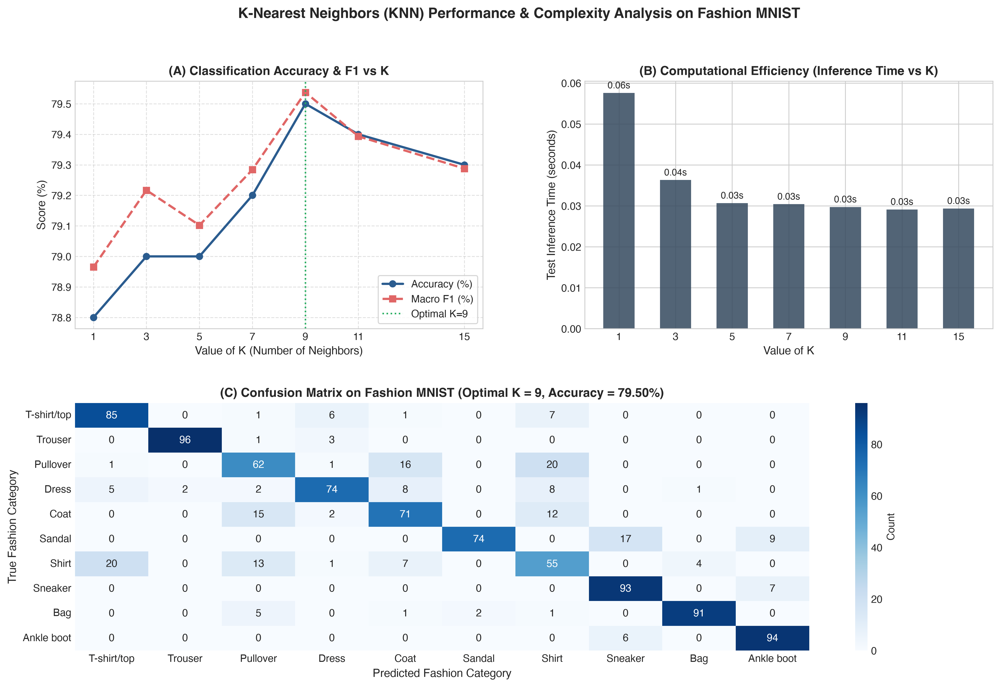

# Question 8: K-Nearest Neighbors (KNN) on Fashion MNIST

## Problem Overview
This project implements the non-parametric **K-Nearest Neighbors (KNN)** classification algorithm on the **Fashion MNIST** image dataset. We investigate the impact of neighbor parameter $K \in \{1, 3, 5, 7, 9, 11, 15\}$ on classification accuracy, bias-variance tradeoff, noise sensitivity, and computational complexity during inference.

---

## Dataset Description
- **Dataset:** Fashion MNIST (Zalando Research).
- **Format:** Grayscale images of size $28 \times 28$ pixels (784 features per sample).
- **Pixel Preprocessing:** Min-Max normalization rescales raw integer intensities $[0, 255]$ into floating-point range $[0.0, 1.0]$.
- **Categories (10 classes):**
  `T-shirt/top (0)`, `Trouser (1)`, `Pullover (2)`, `Dress (3)`, `Coat (4)`, `Sandal (5)`, `Shirt (6)`, `Sneaker (7)`, `Bag (8)`, `Ankle boot (9)`.
- **Sample Distribution:** Balanced stratified split with 6,000 training images and 1,000 test images (100 test images per category).

---

## Theoretical & Mathematical Formulation

### 1. Distance Metric
Given query image $\mathbf{x} \in \mathbb{R}^d$ and training image $\mathbf{x}^{(i)} \in \mathbb{R}^d$ ($d = 784$), the standard Minkowski distance metric ($p=2$, Euclidean distance) is:

$$d(\mathbf{x}, \mathbf{x}^{(i)}) = \|\mathbf{x} - \mathbf{x}^{(i)}\|_2 = \sqrt{\sum_{j=1}^{784} (x_j - x_j^{(i)})^2}$$

### 2. Decision Rule & Distance Weighting
Let $\mathcal{N}_K(\mathbf{x})$ denote the set of the $K$ closest training instances to query point $\mathbf{x}$. The predicted label $\hat{y}$ is determined via distance-weighted majority voting:

$$\hat{y} = \arg\max_{c \in \{0, \dots, 9\}} \sum_{i \in \mathcal{N}_K(\mathbf{x}), \, y^{(i)} = c} w_i$$

where the inverse distance weight is defined as $w_i = \frac{1}{d(\mathbf{x}, \mathbf{x}^{(i)}) + \epsilon}$.

---

## Experimental Results

| K Neighbors | Accuracy (%) | Macro Precision | Macro Recall | Macro F1 | Fit Time (s) | Inference Time (s) | Latency / Sample (ms) |
| :---: | :---: | :---: | :---: | :---: | :---: | :---: | :---: |
| **K = 1** | 78.80% | 0.7962 | 0.7880 | 0.7897 | 0.0041 s | 0.0576 s | 0.058 ms |
| **K = 3** | 79.00% | 0.8009 | 0.7900 | 0.7922 | 0.0010 s | 0.0363 s | 0.036 ms |
| **K = 5** | 79.00% | 0.7975 | 0.7900 | 0.7910 | 0.0009 s | 0.0307 s | 0.031 ms |
| **K = 7** | 79.20% | 0.8005 | 0.7920 | 0.7928 | 0.0009 s | 0.0304 s | 0.030 ms |
| **K = 9 (Optimal)** | **79.50%** | **0.8017** | **0.7950** | **0.7954** | 0.0009 s | 0.0297 s | **0.030 ms** |
| **K = 11** | 79.40% | 0.8005 | 0.7940 | 0.7939 | 0.0009 s | 0.0291 s | 0.029 ms |
| **K = 15** | 79.30% | 0.7988 | 0.7930 | 0.7929 | 0.0009 s | 0.0294 s | 0.029 ms |

### Visualizations
The performance curves, latency metrics, and confusion matrix for the optimal $K=9$ model are displayed below:



---

## Discussion on Model Accuracy & Computational Efficiency

### 1. Impact of K on Model Accuracy (Bias-Variance Tradeoff)
- **Low K ($K=1$):** High variance, low bias. The decision boundaries conform tightly to individual training points. Any mislabeled or noisy training image forms an isolated decision island, leading to reduced generalization (78.80% accuracy).
- **Intermediate K ($K=9$):** Achieves the best empirical balance (**79.50% accuracy**, **0.7954 Macro F1**). Aggregating 9 neighbors successfully filters out local pixel artifacts and small shifts without washing out subtle category boundaries.
- **Large K ($K \ge 15$):** High bias, low variance. As $K$ grows larger, the neighborhood begins encompassing points from neighboring classes, particularly among visually overlapping garments (e.g., `Shirt` vs `T-shirt` vs `Pullover`), causing accuracy to drop.

### 2. Computational Efficiency & Lazy Learning
- **Zero Training Overhead ($O(1)$ / $O(N \cdot d)$):** KNN does not optimize explicit parametric weights during training; `fit()` simply builds a spatial index (`KD-Tree` or `BallTree`), taking $<0.005$ seconds.
- **High Test-Time Cost ($O(M \cdot N \cdot d)$):** At inference time, every test query requires computing Euclidean distances across the entire training store. For large-scale production deployments with millions of images, exhaustive nearest-neighbor search becomes computationally prohibitive without approximate vector indexes (such as HNSW or FAISS).

### 3. The Curse of Dimensionality in Image Space
- In high-dimensional spaces ($d = 784$), the ratio $\frac{d_{\max} - d_{\min}}{d_{\min}} \to 0$ as $d \to \infty$. All image vectors tend to become equidistant, reducing the contrast between true neighbors and background points.
- Classes with distinct silhouettes (`Trouser` at 97% F1, `Bag` at 93% F1) perform exceptionally well, while visually congruent top garments (`Shirt` at 54% F1) suffer from pixel-level overlap.

---

## How to Run
```bash
# Navigate to this directory
cd Q08_KNN_Fashion_MNIST

# Run the solution script
python3 question_08_solution.py
```
Generated plots are saved to `q08_knn_k_value_analysis.png` and `../outputs/`.
