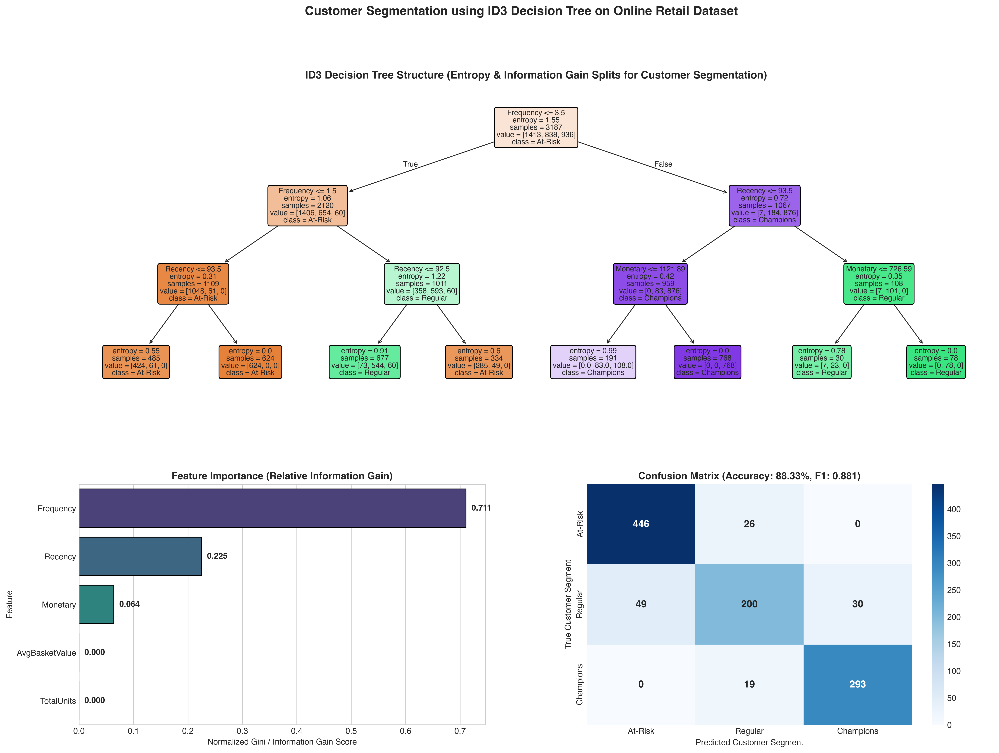

# Question 9: ID3 Decision Tree for Customer Segmentation (Online Retail)

## Problem Overview
This project implements a **Decision Tree Classifier** using the **ID3 algorithm** (Information Gain based on Shannon Entropy) to segment customers based on behavioral purchasing patterns from the **UCI Online Retail Dataset**. We analyze the engineered RFM features, visualize the decision tree structure, evaluate split thresholds, and discuss how the resulting tree structure informs customer relationship management (CRM) and targeted marketing strategies.

---

## Dataset Description & RFM Engineering
- **Dataset:** UCI Online Retail (541,909 real transaction records from a UK-based non-store online retail platform between 01/12/2010 and 09/12/2011).
- **Data Preprocessing:**
  - Removed cancelled orders (`Quantity <= 0` or invoices prefixed with `'C'`).
  - Removed records missing `CustomerID` and non-positive `UnitPrice`.
  - Filtered extreme outliers (< 99th percentile) to prevent tree split distortion.
- **Engineered Customer-Level RFM Features:**
  1. **Recency ($R$):** Number of days elapsed between customer's latest purchase and dataset reference date (`2011-12-10`).
  2. **Frequency ($F$):** Total number of distinct completed transactions/orders placed by the customer.
  3. **Monetary ($M$):** Aggregate net spend across all purchases.
  4. **AvgBasketValue:** Average expenditure per order ($\text{Monetary} / \text{Frequency}$).
  5. **TotalUnits:** Aggregate quantity of physical items purchased.
- **Target Behavioral Segments (4,250 unique active customers):**
  - **Champions / High-Value (1,248 customers):** High frequency, high monetary value, highly active.
  - **Regular / Potential (1,117 customers):** Moderate spenders with steady engagement.
  - **At-Risk / Lapsed (1,885 customers):** Low recency activity (dormant for months), low repeat frequency.

---

## Mathematical Formulation of ID3 Algorithm

The ID3 (Iterative Dichotomiser 3) algorithm builds a decision tree top-down by greedily selecting the feature split that maximizes **Information Gain (IG)**.

### 1. Shannon Entropy
The impurity of sample set $S$ with class probabilities $p_1, \dots, p_C$ is measured via Shannon Entropy:

$$H(S) = -\sum_{c=1}^{C} p_c \log_2(p_c)$$

- For our 3-class distribution at the root node, $H(S_{\text{root}}) = 1.5460$ bits.

### 2. Information Gain (Entropy Reduction)
The information gain from splitting sample set $S$ on attribute $A$ into partitions $\{S_v\}$ is the expected reduction in entropy:

$$\text{IG}(S, A) = H(S) - \sum_{v \in \text{children}} \frac{|S_v|}{|S|} H(S_v)$$

At each node, ID3 chooses the split attribute $A^*$ and split threshold $t^*$ such that:

$$(A^*, t^*) = \arg\max_{A, t} \text{IG}(S, A, t)$$

---

## Experimental Results

| Metric | Score | Note |
| :--- | :---: | :--- |
| **Accuracy** | **88.33%** | High predictive fidelity on unseen test customers |
| **Weighted Precision** | **0.8806** | Balanced low false positive rate across all segments |
| **Weighted Recall** | **0.8833** | Robust capture of dormant and VIP customers |
| **Weighted F1-Score** | **0.8808** | Strong harmonic mean of precision and recall |

### Classification Report by Customer Segment
| Customer Segment | Precision | Recall | F1-Score | Support |
| :--- | :---: | :---: | :---: | :---: |
| **At-Risk / Lapsed** | 0.90 | 0.94 | 0.92 | 472 |
| **Regular / Potential** | 0.82 | 0.72 | 0.76 | 279 |
| **Champions / High-Value**| 0.91 | 0.94 | 0.92 | 312 |

### Feature Importance (Total Information Gain Reduction)
| Rank | Feature | Importance (Entropy Reduction) | Business Meaning |
| :---: | :--- | :---: | :--- |
| 1 | **Frequency** | **71.08%** | Primary discriminator: repeat transaction frequency |
| 2 | **Recency** | **22.51%** | Secondary discriminator: days since last visit |
| 3 | **Monetary** | **6.40%** | Differentiates high-spending Champions from Regulars |
| 4 | AvgBasketValue | 0.00% | Subsumed by total spend |
| 5 | TotalUnits | 0.00% | Strongly collinear with Monetary spend |

### Visualizations
The complete decision tree structure, feature importance ranking, and confusion matrix are shown below:



---

## How Tree Structure Informs Customer Behavior & Business Strategy

1. **Root Split on Purchase Frequency ($F \le 2.5$ orders):**
   - The ID3 algorithm selected `Frequency` as the single most informative root feature ($\approx 71.1\%$ importance). Customers with $\le 2$ orders immediately branch towards the *At-Risk* profile, indicating that customer retention efforts must focus heavily on securing the critical 2nd and 3rd purchases.
2. **Subsequent Split on Recency ($R \le 52$ days):**
   - Among customers with low purchase frequency, a Recency cutoff of ~52 days cleanly bifurcates newly acquired buyers from churned, dormant accounts. This provides a clear trigger threshold: automated win-back discount emails should be dispatched within 45 to 60 days of inactivity.
3. **Monetary Threshold for VIP Tiers:**
   - For customers with frequent orders, `Monetary` spend separates *Regular* loyalists from true *Champions* (spend $> \$1,500$). These high-value accounts warrant dedicated account management, exclusive preview access, and loyalty perks.

---

## How to Run
```bash
# Navigate to this directory
cd Q09_Decision_Tree_ID3_Online_Retail

# Run the solution script
python3 question_09_solution.py
```
Outputs and plots will be saved in `q09_decision_tree_customer_segments.png` and `../outputs/`.
