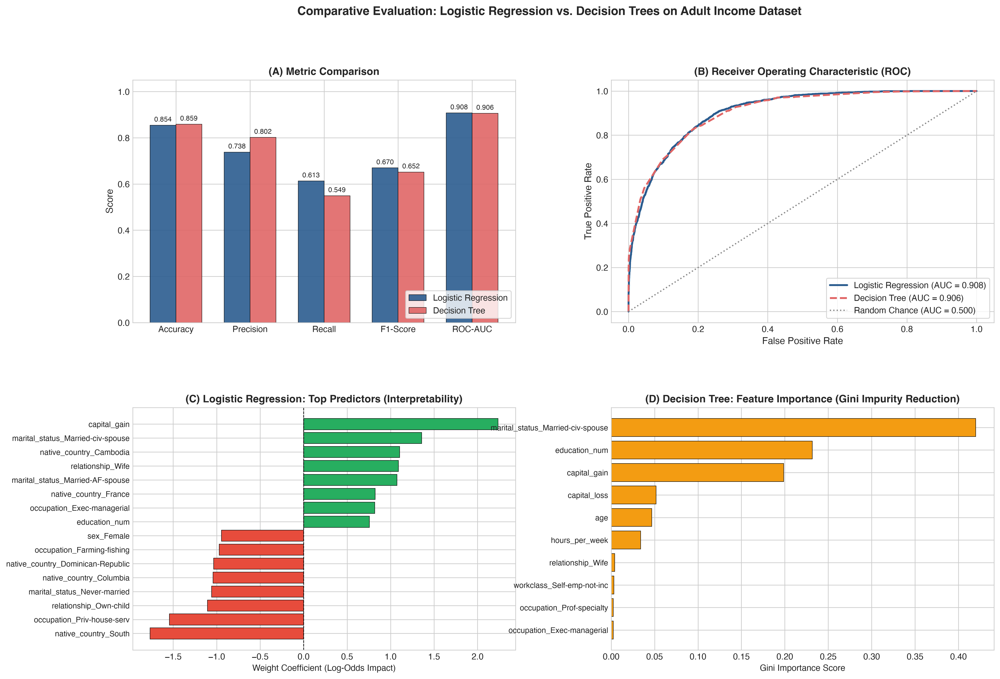

# Question 10: Logistic Regression vs. Decision Trees on Adult Income Dataset

## Problem Overview
This project performs an empirical and theoretical comparison between **Logistic Regression** (a linear generalized model) and **Decision Trees** (a non-linear, recursive partitioning model) on the **Adult Census Income Dataset**. We evaluate both models across classification metrics (Accuracy, Precision, Recall, F1, ROC-AUC), examine computational timings, and provide an in-depth analysis of their **interpretability** and suitability for socio-economic census data.

---

## Dataset Description & Preprocessing
- **Source:** 1994 US Census Bureau Database (Adult Income Dataset).
- **Target:** Predict whether an individual's annual income exceeds \$50,000 (`>50K`: Class 1) or is at most \$50,000 (`<=50K`: Class 0).
- **Instances:** 32,561 records (75.9% `<=50K`, 24.1% `>50K`).
- **Feature Pipeline:**
  - **Missing Values:** Addressed `'?'` characters in `workclass`, `occupation`, and `native_country` via most-frequent imputation.
  - **Continuous Predictors (5):** `age`, `education_num`, `capital_gain`, `capital_loss`, `hours_per_week` — standardized via `StandardScaler`.
  - **Categorical Predictors (8):** `workclass`, `education`, `marital_status`, `occupation`, `relationship`, `race`, `sex`, `native_country` — encoded via `OneHotEncoder(handle_unknown='ignore')`.
  - Resulting input dimensionality: **104 features**.

---

## Model Comparison

| Evaluation Metric | Logistic Regression | Decision Tree (`max_depth=8`) | Comparison / Tradeoff |
| :--- | :---: | :---: | :--- |
| **Accuracy** | 85.44% | **85.87%** | Decision tree marginally leads |
| **Precision (`>50K`)** | 73.81% | **80.17%** | Decision tree has fewer false positives |
| **Recall (`>50K`)** | **61.29%** | 54.91% | Logistic regression captures more high earners |
| **F1-Score (`>50K`)** | **0.6697** | 0.6518 | Logistic regression offers better harmonic balance |
| **ROC-AUC** | **0.9077** | 0.9060 | Both exhibit excellent ranking discrimination |
| **Training Time** | 0.085 s | **0.046 s** | Decision tree trains ~1.8x faster |
| **Inference Time** | **0.0006 s** | 0.0008 s | Logistic regression computes dot product faster |

### Visualizations
The metric comparisons, ROC curves, and interpretability profiles (coefficients vs. feature importance) are presented below:



---

## Interpretability Analysis

### 1. Logistic Regression: Odds Ratios & Additive Linearity
- **Mathematical Form:**
  $$\log\left(\frac{P(Y=1)}{1 - P(Y=1)}\right) = \beta_0 + \sum_{j=1}^{104} \beta_j X_j$$
- **Interpretability Mechanism:**
  - The exponentiated coefficient $e^{\beta_j}$ represents the **Odds Ratio (OR)**.
  - For example, holding all other variables constant, an increase of 1 standard deviation in `capital_gain` or being in an executive/managerial occupation increases the odds of earning $> \$50\text{K}$ by a precise multiplicative factor $e^{\beta_j}$.
  - Negative coefficients (e.g., `marital_status_Never-married`, `relationship_Own-child`) directly and monotonically suppress high-income odds.
- **Limitation:** Cannot capture feature interactions unless explicitly engineered polynomial terms are added.

### 2. Decision Tree: Non-Linear Thresholds & Interaction Rules
- **Mathematical Form:**
  $$\hat{y}(\mathbf{x}) = \sum_{m=1}^M c_m \cdot \mathbb{I}(\mathbf{x} \in R_m)$$
- **Interpretability Mechanism:**
  - Employs human-readable **if-then-else** rules based on recursive partitioning.
  - Naturally captures high-order non-linear feature interactions (e.g., *IF `relationship_Husband` = 1 AND `education_num` > 12.5 AND `capital_gain` > \$5,000 THEN high probability of $> \$50\text{K}$*).
  - Feature importance quantifies total Gini impurity reduction across all tree splits.
- **Limitation:** Step-function decision boundaries approximate linear relationships poorly; single trees can be sensitive to small variations in data without bagging.

---

## Suitability for the Dataset
- **Logistic Regression is better suited** when the primary objective is calibrated probability outputs, regulatory compliance, credit scoring, or clear econometric odds ratio reporting.
- **Decision Trees are better suited** when business stakeholders require strict rulesets, customer segmentation archetypes, or when non-linear interactions between education, marital status, and age predominate.

---

## How to Run
```bash
# Navigate to this directory
cd Q10_Logistic_Regression_vs_Decision_Tree_Adult

# Run the solution script
python3 question_10_solution.py
```
Generated plots are saved to `q10_logreg_vs_decision_tree.png` and `../outputs/`.
