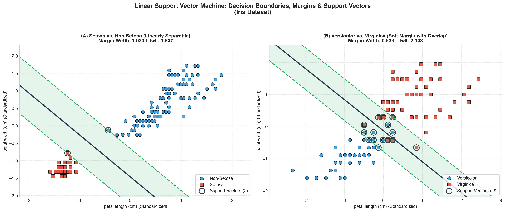

# Question 11: Linear Support Vector Machine (SVM) on Iris Dataset

## Problem Overview
This project implements a **Linear Support Vector Machine (SVM)** on the classic Fisher **Iris dataset**. By projecting the data into a 2D feature subspace (`Petal Length` and `Petal Width`), we directly visualize the **maximum-margin hyperplane**, the **canonical margin boundaries**, and the **support vectors**. We provide a rigorous mathematical discussion of the primal and dual optimization problems, the Karush-Kuhn-Tucker (KKT) conditions, and how the geometric margin governs statistical generalization.

---

## Mathematical Formulation

### 1. The Hyperplane & The Margin
A linear hyperplane is defined by parameter vector $\mathbf{w} \in \mathbb{R}^d$ and bias $b \in \mathbb{R}$:

$$\mathbf{w}^T \mathbf{x} + b = 0$$

For linearly separable training instances $\{(\mathbf{x}_i, y_i)\}_{i=1}^N$ with binary labels $y_i \in \{-1, +1\}$, the canonical hyperplanes bounding the margin are:

$$\mathbf{w}^T \mathbf{x} + b = +1 \quad \text{and} \quad \mathbf{w}^T \mathbf{x} + b = -1$$

The perpendicular distance from any point $\mathbf{x}_i$ to the separating hyperplane is:

$$\gamma_i = \frac{y_i (\mathbf{w}^T \mathbf{x}_i + b)}{\|\mathbf{w}\|_2}$$

The **geometric margin** $\gamma$ of the classifier is the minimum distance to the closest data point. For canonical scaling ($y_i(\mathbf{w}^T \mathbf{x}_i + b) \ge 1$):

$$\gamma = \frac{1}{\|\mathbf{w}\|_2} + \frac{1}{\|\mathbf{w}\|_2} = \frac{2}{\|\mathbf{w}\|_2}$$

Maximizing the geometric margin $\frac{2}{\|\mathbf{w}\|_2}$ is equivalent to minimizing the convex quadratic objective $\frac{1}{2}\|\mathbf{w}\|_2^2$.

### 2. Primal Soft-Margin Optimization Problem
When classes overlap (non-separable case), slack variables $\xi_i \ge 0$ are introduced with regularization hyperparameter $C > 0$:

$$\min_{\mathbf{w}, b, \boldsymbol{\xi}} \frac{1}{2} \|\mathbf{w}\|_2^2 + C \sum_{i=1}^N \xi_i$$

$$\text{subject to } \quad y_i (\mathbf{w}^T \mathbf{x}_i + b) \ge 1 - \xi_i, \quad \xi_i \ge 0 \quad \forall i$$

### 3. Dual Problem & KKT Complementary Slackness
Using Lagrange multipliers $\alpha_i \ge 0$, the dual optimization problem is:

$$\max_{\boldsymbol{\alpha}} \sum_{i=1}^N \alpha_i - \frac{1}{2} \sum_{i=1}^N \sum_{j=1}^N \alpha_i \alpha_j y_i y_j (\mathbf{x}_i^T \mathbf{x}_j)$$

$$\text{subject to } \quad 0 \le \alpha_i \le C, \quad \sum_{i=1}^N \alpha_i y_i = 0$$

From the KKT conditions, the optimal weight vector is a linear combination **only** of the training samples:

$$\mathbf{w}^* = \sum_{i=1}^N \alpha_i y_i \mathbf{x}_i$$

The complementary slackness condition states:

$$\alpha_i \left[ y_i (\mathbf{w}^T \mathbf{x}_i + b) - 1 + \xi_i \right] = 0$$

- If a point lies strictly outside the margin ($y_i(\mathbf{w}^T \mathbf{x}_i + b) > 1$), then $\alpha_i = 0$. Such points have **zero influence** on $\mathbf{w}^*$ or the decision boundary.
- Only points with $\alpha_i > 0$ are **Support Vectors**. They lie directly on the margin boundaries ($\xi_i = 0$) or violate the margin ($\xi_i > 0$).

---

## Experimental Results

| Experiment | Target Classes | Linear Separability | Classification Accuracy | Number of Support Vectors | Margin Width ($\frac{2}{\|\mathbf{w}\|}$) |
| :--- | :---: | :---: | :---: | :---: | :---: |
| **Experiment A** | Setosa vs. Non-Setosa | **Linearly Separable** | **100.00%** | **2 support vectors** | **1.0326** |
| **Experiment B** | Versicolor vs. Virginica | Overlapping / Soft Margin | **94.00%** | **19 support vectors** | **0.9333** |

### Visualizations
The 2D decision hyperplanes, margin boundaries, and support vector locations are shown below:



---

## Discussion on the Margin & Generalization Theory

1. **How the Margin is Determined:**
   - In Experiment A (Setosa vs. Non-Setosa), exactly **2 support vectors** (one from each class) pin down the entire boundary. Removing all other 148 data points leaves the optimal hyperplane completely unchanged.
   - In Experiment B (Versicolor vs. Virginica), the boundary must tolerate boundary violations. 19 support vectors define the trade-off governed by $C$: small $C$ widens the margin at the expense of training errors, while large $C$ forces a tighter margin to penalize slack.
2. **Influence on Generalization (Statistical Learning Theory):**
   - According to Vapnik's Structural Risk Minimization (SRM), the Vapnik-Chervonenkis (VC) dimension $h$ of canonical hyperplanes with margin $\gamma$ enclosed in a sphere of radius $R$ satisfies:
     $$h \le \min\left(d, \left\lceil \frac{R^2}{\gamma^2} \right\rceil\right) + 1$$
   - Maximizing the geometric margin $\gamma = \frac{2}{\|\mathbf{w}\|}$ explicitly compresses the VC dimension, reducing model complexity and guaranteeing tighter upper bounds on generalization error on unseen test data.

---

## How to Run
```bash
# Navigate to this directory
cd Q11_Linear_SVM_Iris

# Run the solution script
python3 question_11_solution.py
```
Generated plots are saved to `q11_linear_svm_iris_margin.png` and `../outputs/`.
