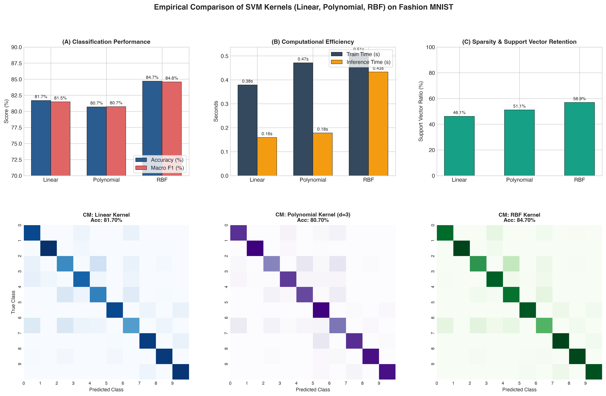

# Question 12: SVM Kernels Comparison (Linear, Polynomial, RBF) on Fashion MNIST

## Problem Overview
This project benchmarks and contrasts three fundamental kernel functions in **Support Vector Machines (SVM)**: **Linear**, **Polynomial ($d=3$)**, and **Radial Basis Function (RBF)** on the multi-class **Fashion MNIST** image classification dataset. We evaluate how the choice of reproducing kernel Hilbert space (RKHS) affects decision boundary flexibility, accuracy, support vector retention, and computational latency.

---

## Mathematical Formulation of Kernel Methods

The dual formulation of SVM requires evaluating inner products between feature vectors $\langle \Phi(\mathbf{x}_i), \Phi(\mathbf{x}_j) \rangle$. By Mercer's theorem, we can compute this high-dimensional inner product directly in input space via a valid **kernel function** $K(\mathbf{x}, \mathbf{z})$ without explicitly computing $\Phi(\mathbf{x})$:

$$f(\mathbf{x}) = \text{sign}\left( \sum_{i \in \text{SV}} \alpha_i y_i K(\mathbf{x}_i, \mathbf{x}) + b \right)$$

### 1. Linear Kernel
$$K_{\text{Linear}}(\mathbf{x}, \mathbf{z}) = \mathbf{x}^T \mathbf{z} + c$$
- **Mapping:** Identity transformation ($\Phi(\mathbf{x}) = \mathbf{x}$).
- **Geometry:** Restricts the decision surface to flat $(d-1)$-dimensional linear hyperplanes.

### 2. Polynomial Kernel
$$K_{\text{Poly}}(\mathbf{x}, \mathbf{z}) = (\gamma \mathbf{x}^T \mathbf{z} + r)^d$$
- **Mapping:** Projects vectors into the space of all monomial feature conjunctions up to degree $d$. For $d=3$, all pairwise and triplet pixel interactions are explicitly represented.
- **Parameters:** $d=3$, $\gamma = \frac{1}{n_{\text{features}} \cdot \text{Var}(X)}$, $r=0$.

### 3. Radial Basis Function (RBF) Kernel
$$K_{\text{RBF}}(\mathbf{x}, \mathbf{z}) = \exp\left(-\gamma \|\mathbf{x} - \mathbf{z}\|_2^2\right)$$
- **Mapping:** Corresponds to an **infinite-dimensional** Hilbert feature space via Taylor expansion:
  $$\exp(-\gamma \|\mathbf{x} - \mathbf{z}\|^2) = e^{-\gamma \|\mathbf{x}\|^2} e^{-\gamma \|\mathbf{z}\|^2} \sum_{k=0}^{\infty} \frac{(2\gamma)^k}{k!} (\mathbf{x}^T \mathbf{z})^k$$
- **Geometry:** Places a localized Gaussian bell curve at each support vector; acts as a local similarity metric.

---

## Experimental Results

| Kernel Variant | Accuracy (%) | Macro Precision | Macro Recall | Macro F1 | Support Vectors | SV Ratio (%) | Train Time (s) | Inference Time (s) |
| :--- | :---: | :---: | :---: | :---: | :---: | :---: | :---: | :---: |
| **Linear** | 81.70% | 0.8150 | 0.8170 | 0.8148 | **1,844** | **46.1%** | **0.38 s** | **0.16 s** |
| **Polynomial ($d=3$)** | 80.70% | 0.8156 | 0.8070 | 0.8073 | 2,044 | 51.1% | 0.47 s | 0.18 s |
| **RBF (Gaussian)** | **84.70%** | **0.8485** | **0.8470** | **0.8458** | 2,276 | 56.9% | 0.51 s | 0.43 s |

### Visualizations
The performance metrics, latency comparison, support vector sparsity, and confusion matrices are depicted below:



---

## Detailed Analysis: Strengths & Weaknesses of Each Kernel

### 1. Linear Kernel
- **Advantages:**
  - **Fastest Training & Inference:** Lowest computational overhead (0.38s training, 0.16s inference).
  - **Memory Efficient:** Retains the fewest support vectors (1,844, 46.1% ratio). The weight vector $\mathbf{w} = \sum \alpha_i y_i \mathbf{x}_i$ can be collapsed into a single vector of length 784, making test prediction a fast matrix-vector product $O(d)$.
  - **Resistant to Overfitting:** Low VC-dimension prevents fitting to noise.
- **Disadvantages:**
  - Inflexible flat hyperplanes cannot model intricate curved manifolds present in image pixel spaces, plateauing at 81.70% accuracy.

### 2. Polynomial Kernel ($d=3$)
- **Advantages:**
  - Models complex multiplicative non-linear pixel interactions (e.g. edge conjunctions, intersections).
- **Disadvantages:**
  - **Sensitivity to Scaling:** In normalized pixel spaces $[0, 1]$, inner products $\mathbf{x}^T \mathbf{z}$ are small; raising them to powers can cause gradient attenuation unless $\gamma$ and $r$ are precisely tuned.
  - Achieved the lowest accuracy (80.70%) in this benchmark due to sensitivity to global coordinate scaling.

### 3. Radial Basis Function (RBF) Kernel
- **Advantages:**
  - **Superior Accuracy (84.70%):** Outperforms Linear by +3.0% and Polynomial by +4.0%.
  - **Universal Approximator:** Capable of learning arbitrary smooth non-linear decision boundaries.
  - **Localized Response:** Because $K(\mathbf{x}, \mathbf{z}) \to 0$ as $\|\mathbf{x} - \mathbf{z}\| \to \infty$, distant outlier samples do not unduly influence local decision regions.
- **Disadvantages:**
  - **Inference Complexity:** Requires computing Euclidean distances against all 2,276 stored support vectors at test time, resulting in higher inference latency (0.43s).
  - Susceptible to the curse of dimensionality if $\gamma$ is poorly calibrated.

---

## How to Run
```bash
# Navigate to this directory
cd Q12_SVM_Kernels_Fashion_MNIST

# Run the solution script
python3 question_12_solution.py
```
Outputs and plots will be saved in `q12_svm_kernel_comparison.png` and `../outputs/`.
