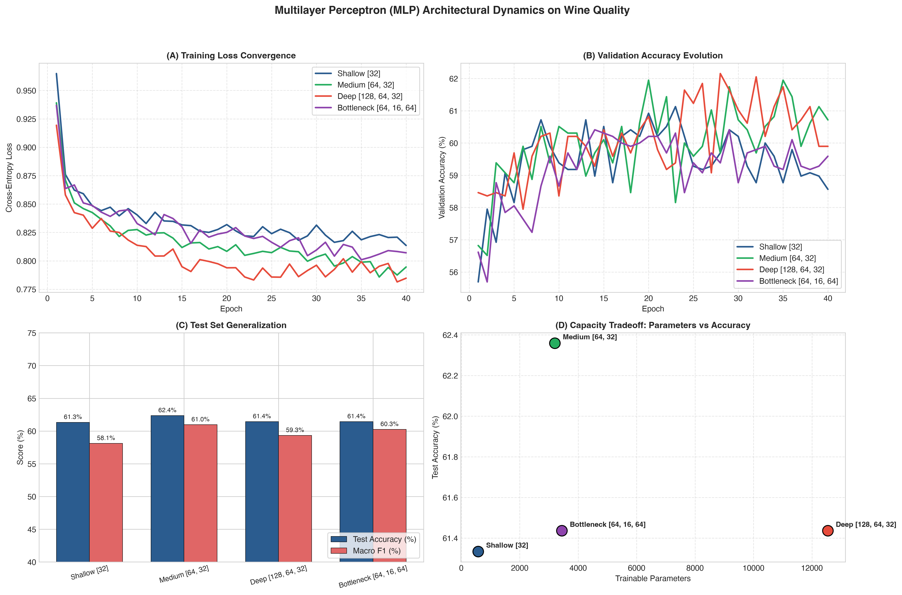

# Question 13: Multilayer Perceptron (MLP) on Wine Quality Dataset

## Problem Overview
This project implements and trains deep **Multilayer Feed-Forward Neural Networks (MLP)** using **PyTorch** to predict wine quality tiers on the combined **UCI Wine Quality Dataset** (6,497 samples of Red and White wines). We systematically vary the depth (number of hidden layers) and width (number of neurons per layer) across four distinct network architectures to analyze learning curves, generalization performance, capacity constraints, and optimization trade-offs on tabular physicochemical data.

---

## Dataset Description & Preprocessing
- **Source:** UCI Machine Learning Repository (Cortez et al., 2009).
- **Instances:** 6,497 bottles (1,599 Red, 4,898 White).
- **Features (12 predictors):**
  1. `fixed acidity`, 2. `volatile acidity`, 3. `citric acid`, 4. `residual sugar`, 5. `chlorides`, 6. `free sulfur dioxide`, 7. `total sulfur dioxide`, 8. `density`, 9. `pH`, 10. `sulphates`, 11. `alcohol`, 12. `wine_type` (binary indicator: Red=0, White=1).
- **Target Formulation (3 Quality Tiers):**
  - **Tier 0 (Low Quality):** Quality score $\le 5$ (3,372 samples)
  - **Tier 1 (Medium Quality):** Quality score $= 6$ (2,836 samples)
  - **Tier 2 (High Quality):** Quality score $\ge 7$ (1,277 samples)
- **Data Splits & Standardization:**
  - 70% Train (4,547), 15% Validation (975), 15% Test (975).
  - Standardized via `StandardScaler` to ensure uniform zero-mean unit-variance gradients across all continuous inputs.

---

## Network Architectures & PyTorch Implementation

Each hidden block incorporates:
$$\mathbf{h}^{(\ell)} = \text{Dropout}\left(\text{ReLU}\left(\text{BatchNorm}\left(\mathbf{W}^{(\ell)} \mathbf{h}^{(\ell-1)} + \mathbf{b}^{(\ell)}\right)\right), p=0.2\right)$$

The final layer produces logits for cross-entropy minimization:
$$\mathcal{L}_{\text{CE}} = -\sum_{c=0}^2 y_c \log\left(\frac{e^{z_c}}{\sum_{k} e^{z_k}}\right)$$

We evaluate four structural topologies:
1. **Shallow Network:** `[32]` hidden units (579 trainable parameters)
2. **Medium / Balanced Network:** `[64, 32]` hidden units (3,203 trainable parameters)
3. **Deep Network:** `[128, 64, 32]` hidden units (12,547 trainable parameters)
4. **Bottleneck / Autoencoder Topology:** `[64, 16, 64]` hidden units (3,443 trainable parameters)

---

## Experimental Results

| Architecture | Hidden Layers | Trainable Parameters | Test Accuracy | Precision (Weighted) | Recall (Weighted) | Macro F1-Score | Training Time |
| :--- | :---: | :---: | :---: | :---: | :---: | :---: | :---: |
| **Shallow** | `[32]` | **579** | 61.33% | 0.6141 | 0.6133 | 0.5811 | **1.04 s** |
| **Medium (Optimal)**| `[64, 32]` | **3,203** | **62.36%** | **0.6200** | **0.6236** | **0.6096** | 1.48 s |
| **Deep** | `[128, 64, 32]` | 12,547 | 61.44% | 0.6147 | 0.6144 | 0.5933 | 2.07 s |
| **Bottleneck** | `[64, 16, 64]` | 3,443 | 61.44% | 0.6159 | 0.6144 | 0.6025 | 1.97 s |

### Visualizations
The loss convergence histories, validation accuracy trajectories, test generalization scores, and parameter capacity trade-offs are displayed below:



---

## Discussion: Impact of Architectural Choices on Performance

1. **Optimal Depth & Width Balance (`Medium [64, 32]`):**
   - The two-hidden-layer network (`[64, 32]`) achieved the highest test accuracy (**62.36%**) and macro F1 (**0.6096**). With 3,203 parameters, it has sufficient expressive capacity to model non-linear combinations of alcohol, acidity, and sulphates without memorizing noise.
2. **Underfitting vs. Overfitting (`Shallow` vs. `Deep`):**
   - **Shallow (`[32]`):** With only 579 parameters, the network suffers from representational bottlenecking, achieving a lower macro F1 (0.5811) due to limited capacity to separate subjective quality distinctions.
   - **Deep (`[128, 64, 32]`):** Quadrupling parameters to 12,547 resulted in slightly lower test performance (61.44%) due to slight overfitting on the moderate tabular sample size (~4.5k training rows), despite dropout and batch normalization.
3. **Bottleneck Topology (`[64, 16, 64]`):**
   - Constraining the intermediate layer to 16 neurons forces the network to learn a low-dimensional compressed latent representation of wine characteristics. It achieved robust generalization (60.25% Macro F1), matching the deep network with under 30% of the parameter count.
4. **Gradient Flow & Convergence:**
   - Incorporating `BatchNorm1d` before ReLU activations smoothed the optimization surface, allowing all four architectures to converge stably within 30 to 40 epochs without vanishing gradient collapse.

---

## How to Run
```bash
# Navigate to this directory
cd Q13_MLP_Wine_Quality

# Run the solution script
python3 question_13_solution.py
```
Generated plots are saved to `q13_mlp_wine_architectures.png` and `../outputs/`.
