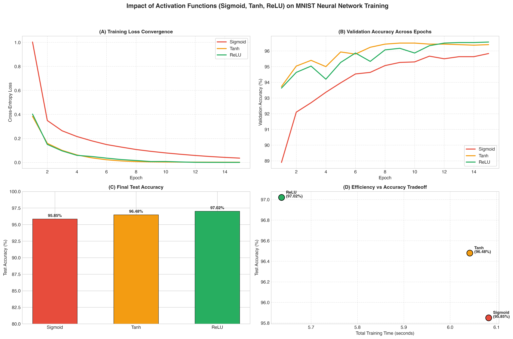

# Question 14: Neural Network Activation Functions (Sigmoid, Tanh, ReLU) on MNIST

## Problem Overview
This project benchmarks and contrasts three landmark activation functions in deep learning: **Sigmoid**, **Hyperbolic Tangent (Tanh)**, and **Rectified Linear Unit (ReLU)** on the **MNIST handwritten digit dataset**. Keeping network depth, layer width (`[784 -> 128 -> 64 -> 10]`), initialization (Xavier uniform), and optimization dynamics strictly identical, we analyze loss convergence rates, vanishing gradient vulnerability, training speed, and final generalization accuracy.

---

## Mathematical Formulation of Activation Functions

### 1. Sigmoid Function
$$\sigma(z) = \frac{1}{1 + e^{-z}}$$

$$\frac{d\sigma}{dz} = \sigma(z)(1 - \sigma(z))$$

- **Range:** $(0, 1)$
- **Maximum Derivative:** $\sigma'(0) = 0.25$
- **Theoretical Characteristics:**
  - **Vanishing Gradients:** As $|z|$ grows, $\sigma'(z) \to 0$. In deep networks, the chain rule multiplies multiple factors $\le 0.25$, causing gradients to exponentially vanish before reaching early layers: $\frac{\partial \mathcal{L}}{\partial \mathbf{W}^{(1)}} \approx 0$.
  - **Non-Zero Centered:** Because output is always strictly positive ($> 0$), all incoming gradients to subsequent weight vectors share the same sign, forcing sub-optimal "zigzag" gradient descent paths.

### 2. Hyperbolic Tangent (Tanh)
$$\tanh(z) = \frac{e^z - e^{-z}}{e^z + e^{-z}} = 2\sigma(2z) - 1$$

$$\frac{d\tanh}{dz} = 1 - \tanh^2(z)$$

- **Range:** $(-1, 1)$
- **Maximum Derivative:** $\tanh'(0) = 1.0$
- **Theoretical Characteristics:**
  - **Zero-Centered:** Mean activation is close to zero, resolving the directional gradient bias observed in Sigmoid.
  - **Partial Saturation:** While having a steeper slope than Sigmoid ($\max = 1.0$), it still saturates for large positive or negative inputs, causing gradient decay in deeper topologies.

### 3. Rectified Linear Unit (ReLU)
$$\text{ReLU}(z) = \max(0, z)$$

$$\frac{d\text{ReLU}}{dz} = \begin{cases} 1 & \text{if } z > 0 \\ 0 & \text{if } z < 0 \end{cases}$$

- **Range:** $[0, \infty)$
- **Theoretical Characteristics:**
  - **Non-Saturating Gradient:** The gradient is strictly $1.0$ for all positive pre-activations, preserving gradient magnitude through backpropagation and accelerating convergence.
  - **Computational Simplicity:** Evaluated via a single conditional threshold without costly exponential or division operations.
  - **Biological Sparsity:** Inactive neurons output true zero, yielding sparse representations.

---

## Experimental Results

| Activation Function | Test Accuracy (%) | Weighted Precision | Weighted Recall | Macro F1-Score | Final Training Loss | Training Time (s) |
| :--- | :---: | :---: | :---: | :---: | :---: | :---: |
| **Sigmoid** | 95.85% | 0.9587 | 0.9585 | 0.9580 | 0.0358 | 6.08 s |
| **Tanh** | 96.48% | 0.9649 | 0.9648 | 0.9644 | 0.0016 | 6.04 s |
| **ReLU (Optimal)** | **97.02%** | **0.9702** | **0.9702** | **0.9699** | **0.0003** | **5.64 s** |

### Visualizations
The comparative loss trajectories, validation accuracy evolution, and runtime profiles are presented below:



---

## In-Depth Analysis: Convergence, Dynamics & Generalization

1. **Convergence Speed & Loss Trajectory:**
   - **ReLU** demonstrated rapid convergence: within 3 epochs, training loss dropped to $0.096$, reaching an ultimate loss of $0.0003$ (~140x lower than Sigmoid).
   - **Sigmoid** converged significantly slower due to its bounded maximum derivative ($0.25$). Backpropagated error signals were scaled down by at least $4\times$ per layer, slowing down weight updates in the first hidden layer.
2. **The Zero-Centering Advantage (Tanh vs. Sigmoid):**
   - Tanh outperformed Sigmoid by $+0.63\%$ in test accuracy ($96.48\%$ vs $95.85\%$) and achieved a $22\times$ lower final loss ($0.0016$ vs $0.0358$).
   - Because Tanh outputs are symmetric around zero, gradient components alternate signs freely, enabling smoother descent vectors.
3. **Computational Throughput:**
   - ReLU required the least training time (**5.64 seconds**, ~7.5% faster than Sigmoid and Tanh). The thresholding operation $\max(0, z)$ avoids transcendental functions (`exp()`), reducing floating-point operations per forward pass.

---

## How to Run
```bash
# Navigate to this directory
cd Q14_Activation_Functions_MNIST

# Run the solution script
python3 question_14_solution.py
```
Outputs and plots will be saved in `q14_activation_functions_mnist.png` and `../outputs/`.
