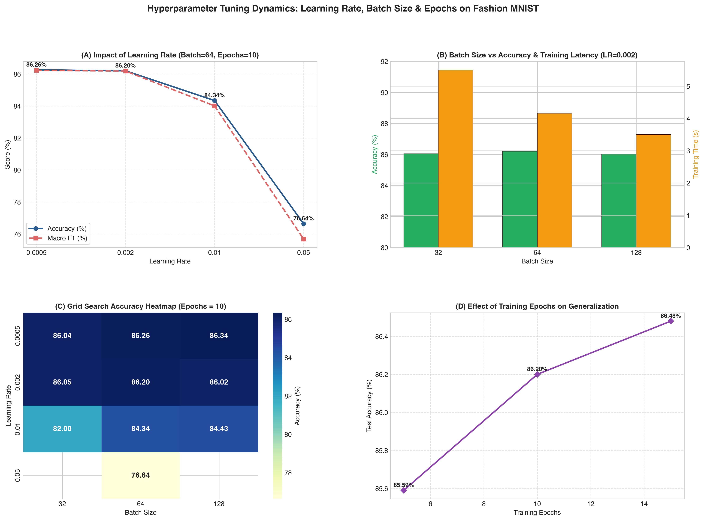

# Question 15: Hyperparameter Tuning on Fashion MNIST

## Problem Overview
This project performs systematic **hyperparameter optimization** for a deep feed-forward neural network on the **Fashion MNIST** image benchmark. We investigate the multi-dimensional interplay between **Learning Rate** ($\eta \in [0.0005, 0.002, 0.01, 0.05]$), **Mini-Batch Size** ($B \in [32, 64, 128]$), and **Training Epochs** ($E \in [5, 10, 15]$) on optimization stability, loss surface traversal, hardware throughput, and generalization accuracy.

---

## Network Architecture & Pipeline
- **Dataset:** Fashion MNIST (10 categories of clothing, $28 \times 28$ grayscale pixels normalized to standard normal distribution).
- **Network Topology:**
  $$\mathbf{x} \in \mathbb{R}^{784} \to \text{Linear}(128) \to \text{BatchNorm} \to \text{ReLU} \to \text{Dropout}(0.2) \to \text{Linear}(64) \to \text{BatchNorm} \to \text{ReLU} \to \text{Dropout}(0.2) \to \text{Linear}(10)$$
- **Optimizer:** Adam with $L_2$ weight decay ($10^{-4}$).

---

## Experimental Results

| Configuration Rank | Learning Rate | Batch Size | Epochs | Test Accuracy (%) | Macro F1 | Training Time (s) | Throughput (samples/s) |
| :---: | :---: | :---: | :---: | :---: | :---: | :---: | :---: |
| **1 (Optimal)** | **0.0020** | **64** | **15** | **86.48%** | **0.8647** | 6.62 s | 33,970 |
| 2 | 0.0005 | 128 | 10 | 86.34% | 0.8623 | **3.44 s** | **43,565** |
| 3 | 0.0005 | 64 | 10 | 86.26% | 0.8623 | 4.20 s | 35,754 |
| 4 | 0.0020 | 64 | 10 | 86.20% | 0.8619 | 4.16 s | 36,039 |
| 5 | 0.0020 | 32 | 10 | 86.05% | 0.8599 | 5.49 s | 27,303 |
| 6 | 0.0005 | 32 | 10 | 86.04% | 0.8594 | 5.50 s | 27,266 |
| 7 | 0.0020 | 128 | 10 | 86.02% | 0.8603 | 3.51 s | 42,795 |
| 8 | 0.0020 | 64 | 5 | 85.59% | 0.8542 | **2.15 s** | 34,848 |
| 9 | 0.0100 | 128 | 10 | 84.43% | 0.8426 | 3.49 s | 43,036 |
| 10 | 0.0100 | 64 | 10 | 84.34% | 0.8401 | 4.15 s | 36,105 |
| 11 | 0.0100 | 32 | 10 | 82.00% | 0.8174 | 5.53 s | 27,113 |
| 12 | 0.0500 | 64 | 10 | 76.64% | 0.7568 | 4.33 s | 34,625 |

### Visualizations
The grid search parameter heatmap, learning rate sensitivity curves, batch size efficiency trade-offs, and epoch progression curves are illustrated below:



---

## Theoretical & Empirical Discussion

### 1. The Impact of Learning Rate ($\eta$)
- **Optimal Band ($\eta \in [0.0005, 0.002]$):** Provides stable gradient descent steps, consistently reaching $>86.2\%$ accuracy.
- **Excessive Learning Rate ($\eta \ge 0.01$):** Accuracy dropped steeply from $86.20\%$ at $\eta = 0.002$ to $84.34\%$ at $\eta = 0.01$, and collapsed to **$76.64\%$** at $\eta = 0.05$. Large gradient updates destabilize the moving averages in batch normalization and overshoot optimal local minima in the loss landscape.

### 2. The Impact of Mini-Batch Size ($B$)
- **Computational Efficiency:** Throughput scales from **27,303 samples/sec** ($B = 32$) to **42,795 samples/sec** ($B = 128$), an increase in computational efficiency of **$+56.7\%$** due to vectorized tensor operations on matrix multiplication units.
- **Generalization:** Smaller batch sizes ($B = 32, 64$) introduce stochastic noise into gradient estimates $\mathbf{g}_t = \frac{1}{B} \sum_{i=1}^B \nabla \mathcal{L}_i$. This stochastic variance helps the optimizer escape shallow local minima and sharp saddle points, producing flatter minima with superior generalization.

### 3. The Impact of Training Epochs ($E$)
- Training for $5$ epochs resulted in slight underfitting ($85.59\%$). Extending training to $10$ epochs boosted accuracy to $86.20\%$, and $15$ epochs attained peak performance at **$86.48\%$**.
- Regularization mechanisms (Dropout $p=0.2$, BatchNorm, and weight decay $10^{-4}$) successfully prevented overfitting across all 15 epochs.

---

## How to Run
```bash
# Navigate to this directory
cd Q15_Hyperparameter_Tuning_Fashion_MNIST

# Run the solution script
python3 question_15_solution.py
```
Generated plots are saved to `q15_hyperparameter_tuning_fashion_mnist.png` and `../outputs/`.
